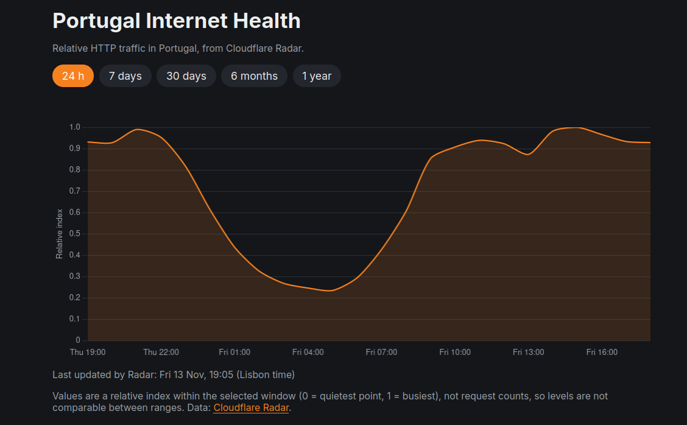

# Portugal Internet Health

A small dashboard for tracking internet traffic in Portugal over time, built on [Cloudflare Workers](https://workers.cloudflare.com/) using data from the [Cloudflare Radar API](https://developers.cloudflare.com/radar/).

**Live demo:** https://radar-pt.franciscojrs.workers.dev



## Overview

This project shows how internet traffic in Portugal changes across different time windows:

- 24 hours
- 7 days
- 30 days
- 6 months
- 1 year

It fetches data from Cloudflare Radar, caches it in Cloudflare KV, and presents it in a simple interactive dashboard with a chart and automatic light/dark mode.

## How it works

```text
Browser ──► Worker ──► KV cache ──hit──► JSON response
              │            │
              │            └─miss─► Radar API ─► validate ─► reshape ─► store in KV ─► JSON response
              │
              └─► static assets (public/)
```

### Components

- `src/index.ts` — Worker entry point and API routing
- `src/radar.ts` — Radar API client, validation, range mapping, and reshaping
- `src/cache.ts` — KV-based cache helper
- `public/` — static frontend assets (`index.html`, `app.js`)
- `wrangler.jsonc` — Worker configuration (KV binding, static assets)

## API

### `GET /api/traffic?range=<range>`

Available values: `1d`, `7d`, `30d`, `6m`, `1y`

Default: `7d`. Any other value returns `400` with the list of allowed values.

Example response (shortened):

```json
{
  "location": "PT",
  "description": "Relative HTTP traffic index (normalized within this window)",
  "normalization": "MIN0_MAX",
  "interval": "ONE_HOUR",
  "range": {
    "start": "2026-11-06T18:00:00Z",
    "end": "2026-11-13T18:00:00Z"
  },
  "updated": "2026-11-13T18:05:00Z",
  "points": [
    { "t": "2026-11-06T18:00:00Z", "v": 0.74 }
  ]
}
```

The response includes an `X-Cache: HIT` or `MISS` header.

## Design notes

- Input values are allowlisted before reaching Radar.
- Cache TTLs vary by range to balance freshness and performance.
- Radar returns normalized values, so the UI labels them as a relative index instead of raw traffic counts.
- Radar rejects fine aggregation intervals for long date ranges, so short ranges use hourly points and the 6 month and 1 year views use weekly points (tested against the API). Short ranges show the daily rhythm; long ranges show the trend.
- The Radar token stays server-side; the browser calls only the Worker endpoint.
- Failed upstream requests are not cached and return a generic `502`.

## Running locally

### Prerequisites

- Node.js and npm
- A free [Cloudflare account](https://dash.cloudflare.com/sign-up)
- A Cloudflare API token with Radar read access

### Setup

```bash
git clone <this repo>
cd <this repo>
npm install

# Local secret (git-ignored)
echo "RADAR_TOKEN=your-token-here" > .dev.vars

# Create your own KV namespace, then replace the id in wrangler.jsonc with the one it prints
npx wrangler kv namespace create CACHE

npx wrangler types
npx wrangler dev
```

Then open http://localhost:8787

### Deploy

```bash
npx wrangler login
npx wrangler secret put RADAR_TOKEN
npx wrangler deploy
```

## What I learned

- How Workers, KV and static assets fit together, and how secrets and bindings differ between local development and production.
- Reading a real API's constraints from its docs and testing them (aggregation limits, normalization) before designing around them.
- Small production concerns: allowlisting input, not caching errors, hiding upstream details, and ignoring out-of-order responses in the UI.

## Possible next steps

- Mark outages and anomalies from Radar's annotations on the chart.
- Refresh the cache on a schedule with a Cron Trigger.
- Add computed statistics (busiest and quietest hour, change versus last week).
- Compare Portugal with other countries.

## Data and attribution

This project uses data from [Cloudflare Radar](https://radar.cloudflare.com/). It is a personal, non-commercial learning project and is not affiliated with Cloudflare. Check Radar's terms of use before reusing its data.